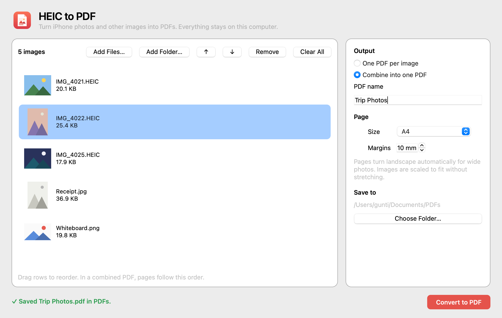
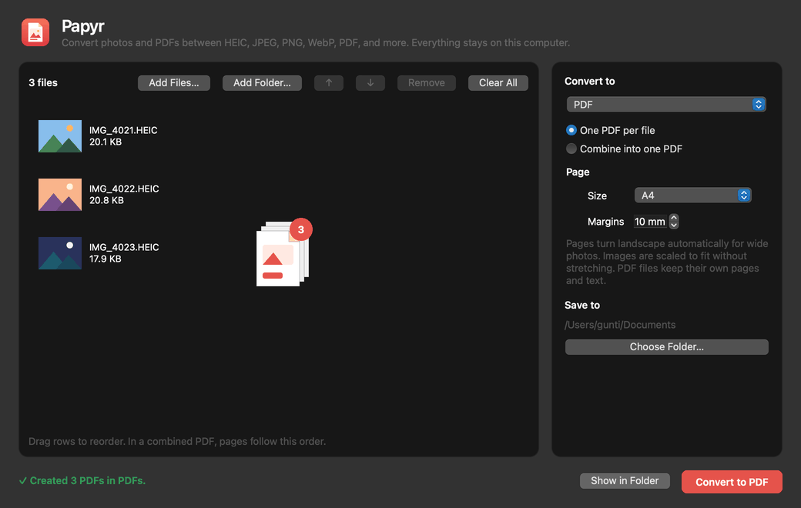
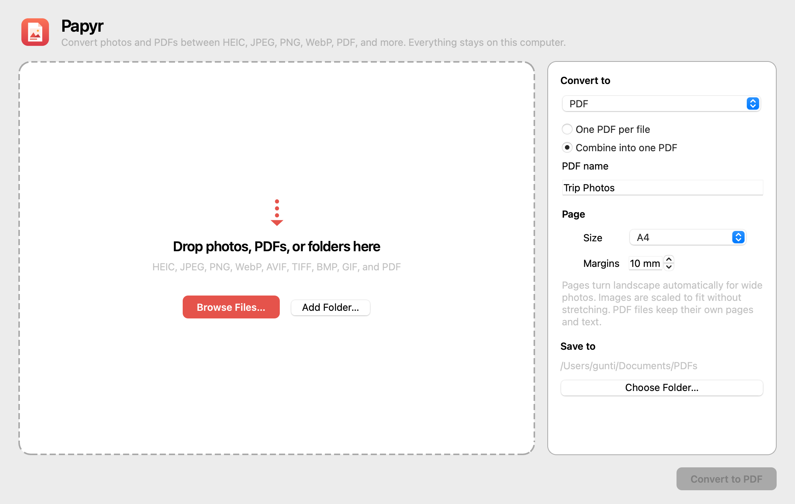
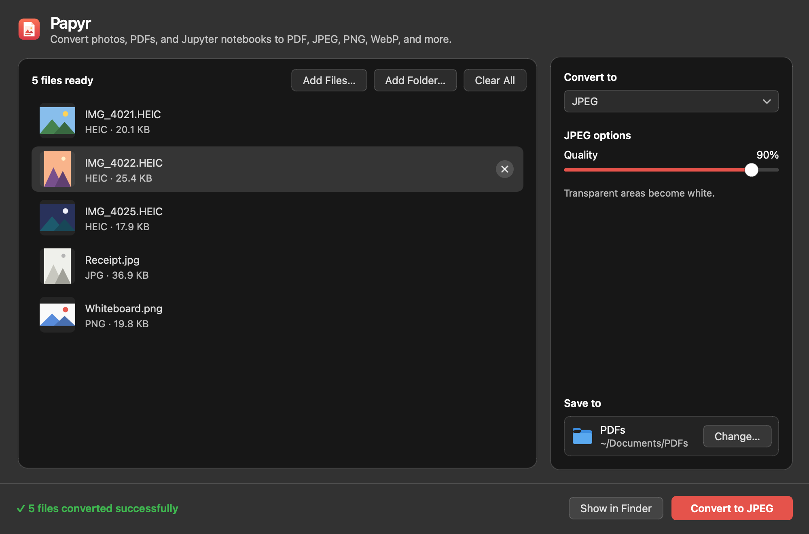

<p align="center"></p>

<h1 align="center">HEIC to PDF</h1>

<p align="center">A free, lightweight, offline desktop application for converting HEIC images to PDF.</p>

<p align="center"><a href="https://github.com/guntisid2007/heic-to-pdf/releases/latest"><b>Download the latest version</b></a></p>



HEIC to PDF turns iPhone photos (HEIC) and ordinary JPEG and PNG images into PDF files. It runs on your computer and never sends your photos anywhere. You do not need Python or any other software to use it.

## Features

- Drag and drop photos or whole folders, or pick them with the Browse button.
- Converts HEIC, HEIF, JPEG, and PNG.
- Shows a thumbnail, name, and size for every image. Remove images, reorder them by dragging or with the arrow buttons, or clear the list.
- **One PDF per image.** Each PDF keeps the photo's original name, such as `IMG_4021.pdf`. Existing files are never overwritten; a number is added instead.
- **Combine into one PDF.** Pages follow the order in the list. You choose the file name.
- Page size: the image's original size, A4, or US Letter.
- Pages turn landscape automatically for wide photos.
- Adjustable margins. Images are scaled to fit without stretching.
- Photos taken sideways or upside down come out the right way up.
- iPhone colours (Display P3) are converted to standard sRGB so they look right in any PDF viewer.
- A progress bar and a Cancel button. The window stays responsive while it works.
- When conversion finishes, the new PDF flies into a folder, and "Show in Folder" opens the results.
- Remembers your output folder and settings.
- Follows your system's light or dark mode.



| Light mode | Dark mode |
| --- | --- |
|  |  |

## Download and install

Go to the [Releases page](https://github.com/guntisid2007/heic-to-pdf/releases/latest) and download the file for your computer.

| Your computer | File to download |
| --- | --- |
| Mac with Apple silicon (M1, M2, M3, M4, and later) | `HEIC-to-PDF-macOS-AppleSilicon.zip` |
| Mac with an Intel processor | `HEIC-to-PDF-macOS-Intel.zip` |
| Windows 10 or 11 (64-bit) | `HEIC-to-PDF-Windows.zip` |
| Linux (x86-64) | `HEIC-to-PDF-Linux-x86_64.tar.gz` |

Not sure which Mac you have? Open the Apple menu and choose **About This Mac**. It says "Chip: Apple M…" for Apple silicon, or "Processor: … Intel" for Intel.

### macOS

1. Double-click the downloaded `.zip` to unzip it. You get **HEIC to PDF.app**.
2. Drag **HEIC to PDF.app** into your **Applications** folder.
3. Open it. The first time, macOS shows a warning that it cannot verify the app, because the app is not signed with a paid Apple Developer certificate (see [Known limitations](#known-limitations)). To open it anyway:
   - Click **Done** (or **OK**) on the warning.
   - Open **System Settings → Privacy & Security**, scroll down, and click **Open Anyway** next to the message about HEIC to PDF.
   - Confirm with your password or Touch ID, then click **Open**.

   You only need to do this once.

### Windows

1. Right-click the downloaded `.zip` and choose **Extract All…**.
2. Open the extracted **HEIC to PDF** folder and double-click **HEIC to PDF.exe**.
3. If Windows SmartScreen says "Windows protected your PC", click **More info**, then **Run anyway**. This appears because the app is not code-signed.

Keep `HEIC to PDF.exe` inside its folder; it needs the files next to it. To make it easy to find, right-click the `.exe` and choose **Send to → Desktop (create shortcut)** or **Pin to Start**.

### Linux

```sh
tar -xzf HEIC-to-PDF-Linux-x86_64.tar.gz
"./HEIC to PDF/HEIC to PDF"
```

The build was made on Ubuntu 22.04 and needs glibc 2.35 or newer plus the usual desktop libraries. If it fails to start on Debian or Ubuntu, install `libxcb-cursor0`.

## How to use

1. Drag photos or folders onto the window, or click **Browse Files…** or **Add Folder…**.
2. Arrange the list. Drag rows, or select a row and use **↑** and **↓**. Press **Delete** or click **Remove** to drop a photo.
3. Under **Output**, choose **One PDF per image** or **Combine into one PDF**. For a combined PDF, type a name.
4. Choose a page size and margins.
5. Click **Choose Folder…** to pick where the PDFs go.
6. Click **Convert to PDF**. When it finishes, click **Show in Folder**.

If a file cannot be read (for example, it is damaged), it is marked in the list. Conversion skips it, carries on with the rest, and tells you which files were skipped.

## Privacy

- Everything happens on your computer. The app makes no network connections.
- No accounts, no telemetry, no analytics, no API keys.
- Photo metadata such as GPS location, camera model, and date is **not** copied into the PDFs.
- The app writes nothing except the PDFs you ask for. Each PDF is written to a temporary file in the destination folder and renamed when complete, so a cancelled or failed conversion leaves no partial files behind.

## Supported systems

| System | Status |
| --- | --- |
| macOS 14.4 (Sonoma) or later, Apple silicon | Built and tested in CI on every release |
| macOS 14.4 (Sonoma) or later, Intel | Built and tested in CI on every release |
| Windows 10 and 11, 64-bit | Built and tested in CI on every release |
| Linux x86-64 (glibc 2.35+) | Built and tested in CI on every release |

"Tested in CI" means the automated test suite runs on that system, and the packaged app converts a real HEIC file to a PDF there before the download is published.

## Known limitations

- **Not code-signed or notarized.** The macOS app has only an ad-hoc signature. It is not signed with an Apple Developer ID or notarized by Apple, so Gatekeeper asks you to approve it once (steps above). The Windows app is not signed either, so SmartScreen may warn. Signing needs paid certificates, which this project does not have.
- PDFs are image PDFs. Text in photos is not searchable (no OCR).
- HEIC and JPEG photos are stored in the PDF as high-quality JPEG (quality 92). PNG images are stored losslessly.
- HDR and wide-gamut detail is converted to standard 8-bit sRGB.
- Images larger than about 178 megapixels are refused to protect your computer's memory.
- Original size uses one image pixel per PDF point (1/72 inch), so a 12-megapixel photo makes a page about 142 × 107 cm. Choose A4 or Letter for printable pages.
- Only the first image of a multi-image HEIC file (such as a burst) is converted.

## Run from source

You need Python 3.10 or newer.

```sh
git clone https://github.com/guntisid2007/heic-to-pdf.git
cd heic-to-pdf
python -m venv .venv
source .venv/bin/activate          # Windows: .venv\Scripts\activate
pip install -r requirements-dev.txt
python src/main.py
```

Run the tests:

```sh
python -m pytest
```

## Build the app yourself

```sh
pyinstaller --noconfirm --clean heic-to-pdf.spec
```

This produces `dist/HEIC to PDF.app` on macOS and `dist/HEIC to PDF/` on Windows and Linux. PyInstaller builds only for the system it runs on, so build on each platform. To check a build, run the packaged binary with `--self-test tests/fixtures/sample.heic`. It exits with code 0 when it converts the sample correctly.

Releases are built by [GitHub Actions](.github/workflows/build.yml). Pushing a tag such as `v1.0.1` runs the tests, builds every platform, smoke-tests each packaged app, and attaches the builds that passed to a new release with a `SHA256SUMS.txt` file.

## Project layout

```
src/main.py            entry point
src/converter/         image decoding, page layout, PDF writing (no GUI code)
src/gui/               Qt window, widgets, and background workers
src/utils/             file collection, output names, bundled asset paths
assets/                app icons
tests/                 pytest suite and a sample HEIC file
scripts/               regenerate icons, screenshots, and the sample HEIC
```

## Contributing

Bug reports and pull requests are welcome.

1. Open an issue that describes the bug or the change.
2. Fork the repository and create a branch.
3. Keep conversion logic in `src/converter/`, with no Qt imports, and add a test for any behaviour change.
4. Run `python -m pytest` and make sure it passes.
5. Open a pull request. CI builds and tests every platform.

Please never add network access, telemetry, or anything that sends images off the user's computer.

## License

[MIT](LICENSE)

Built with [PySide6](https://doc.qt.io/qtforpython-6/) (Qt, LGPLv3), [Pillow](https://python-pillow.org/), and [pillow-heif](https://github.com/bigcat88/pillow_heif) (libheif, LGPLv3). The packaged apps ship these libraries as separate, replaceable files.
