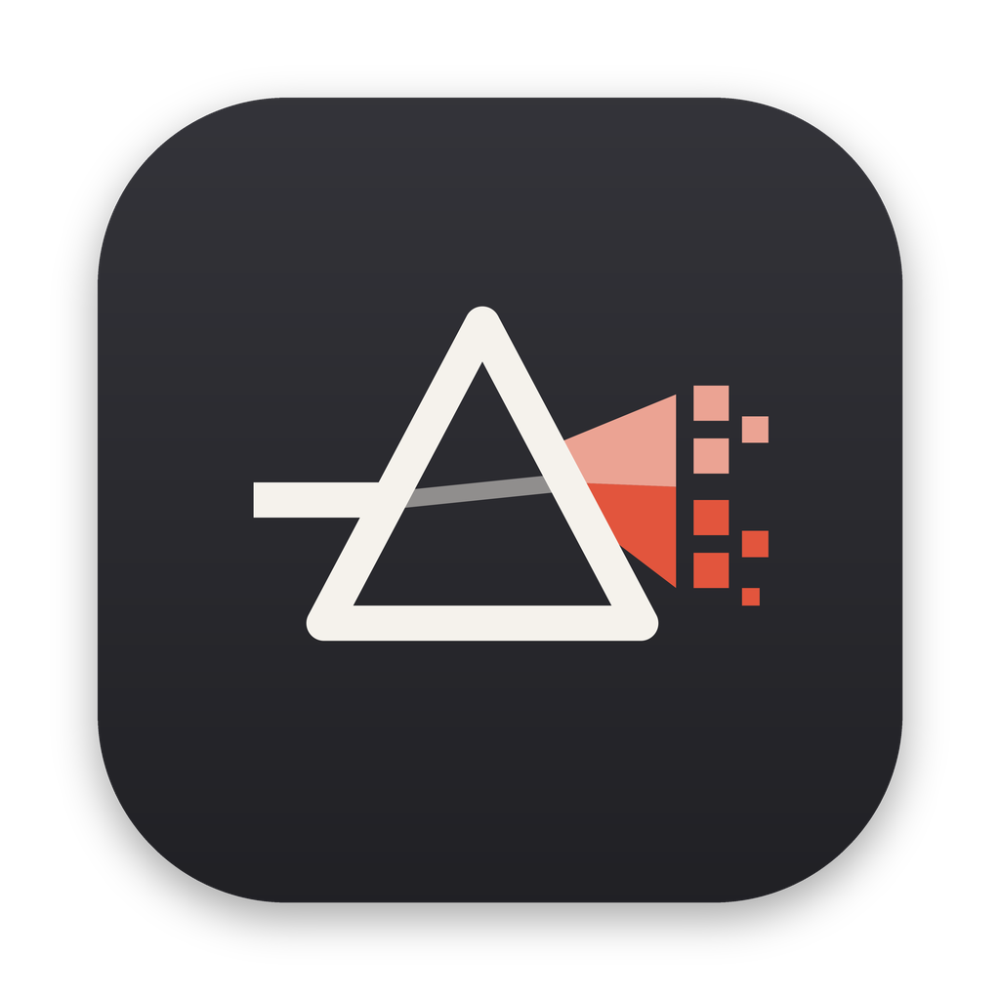
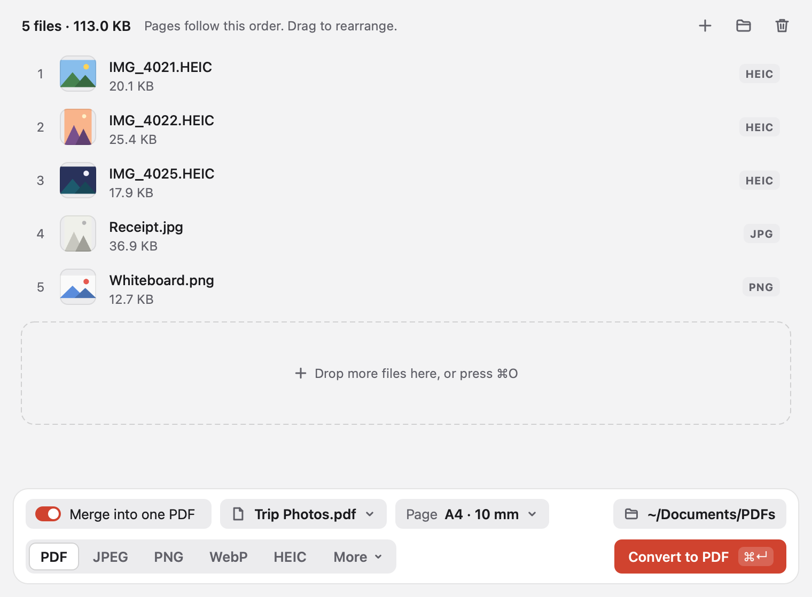
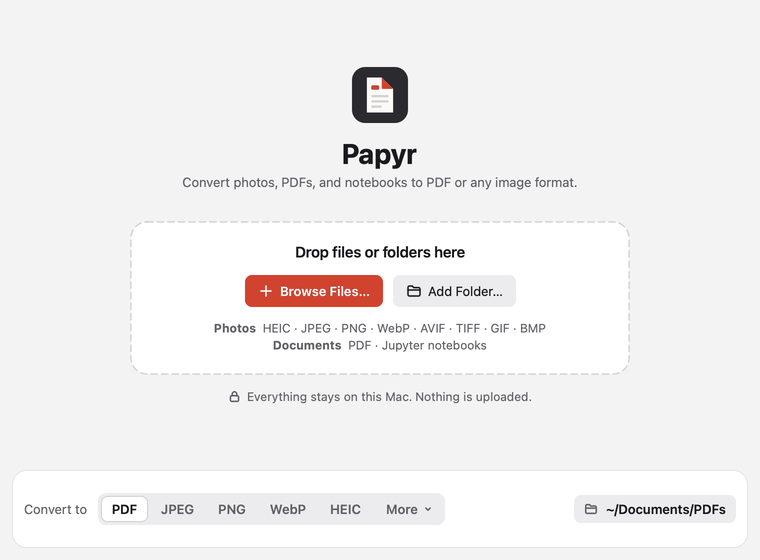
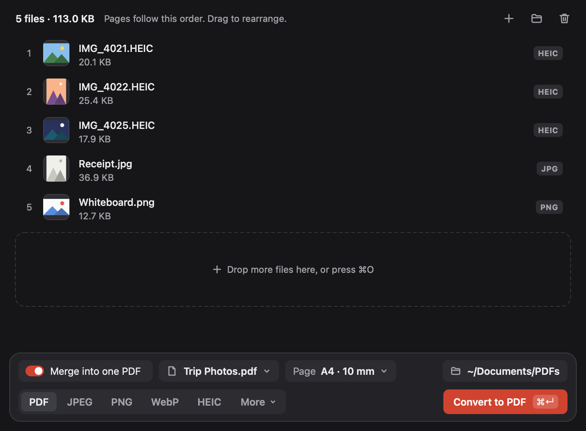
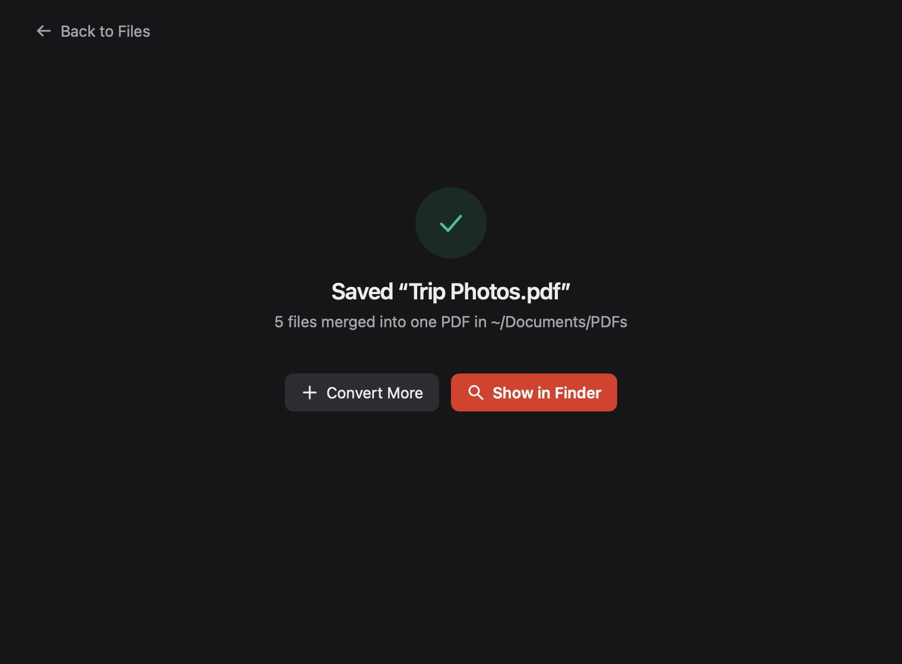

<p align="center"></p>

<h1 align="center">Papyr</h1>

<p align="center">A free, offline desktop converter for photos, PDFs, and Jupyter notebooks.<br>
HEIC, JPEG, PNG, WebP, AVIF, TIFF, BMP, GIF, and PDF, from any of them to any of them.</p>

<p align="center"><a href="https://github.com/guntisid2007/papyr/releases/latest"><b>Download the latest version</b></a></p>



Papyr turns iPhone photos (HEIC) into PDFs or JPEGs, PDFs into images, PNGs into WebP, Jupyter notebooks into PDFs, and any other combination of common image formats and PDF. It runs on your computer and never sends your files anywhere. You do not need Python or any other software to use it.

## Features

- **Any to any.** Reads HEIC, HEIF, JPEG, PNG, WebP, AVIF, TIFF, BMP, GIF, PDF, and Jupyter notebooks (`.ipynb`). Writes PDF, JPEG, PNG, HEIC, WebP, AVIF, TIFF, GIF, and BMP.
- One compact window that moves through three screens: a welcome screen to drop files on, the list of files with everything you need in a dock at the bottom, and a summary when the conversion is done.
- Drag files or whole folders onto the window or the Dock icon, use **Open With** in Finder, or pick them with **Browse Files…**.
- A list with a thumbnail, name, size, and format for every file. Reorder it by dragging or with **Edit → Move Up** and **Move Down**, remove a file with its **×** button, or clear the list. Unreadable files are flagged with the reason as soon as you add them, and files in formats Papyr can't read are skipped with a note. Lists of hundreds of files stay responsive, because previews load in the background.
- The output format is always visible in the dock. The dock shows only the settings that format uses, and each opens a small popover.
- **To PDF:**
  - One PDF per file, or everything combined into one PDF in list order.
  - Page size: original image size, A4, or US Letter. Pages turn landscape automatically for wide photos.
  - Adjustable margins. Images are scaled to fit without stretching.
  - PDFs you add keep their own pages, and their text stays sharp and searchable, so Papyr also merges PDFs.
  - Jupyter notebooks are laid out on your page size and margins, with their markdown, code, and saved outputs (printed text, tables, plots, and errors). The text stays searchable. Papyr shows the outputs saved in the file and never runs the notebook.
- **To an image format:**
  - Adjustable quality for JPEG, HEIC, WebP, and AVIF.
  - Each page of a PDF becomes its own image (`report-page-1.png`, `report-page-2.png`, …), rendered at 100, 150, 200, or 300 DPI.
  - Transparency is kept in PNG, HEIC, WebP, AVIF, TIFF, and GIF, and filled with white in JPEG and BMP.
- Photos taken sideways or upside down come out the right way up.
- Colours are converted to standard sRGB so they look right everywhere.
- Never overwrites anything. If a file with the same name exists, Papyr adds a number, such as `photo (1).jpg`.
- Real progress: the file being converted, how many are done, and how many are left, with a **Cancel** button that keeps the files already finished. The window stays responsive while it works.
- If some files fail, the rest are still saved. The summary says how many were converted, lists each file that failed with a plain reason, and **Retry Failed** puts only those files back in the list. **Show in Finder** (**Show in Explorer** on Windows) selects the result.
- Remembers your output folder and settings, and follows your system's light or dark mode. If the output folder is missing or read-only, Papyr says so before you convert.
- Screens cross-fade in under a fifth of a second, or switch instantly when **Reduce motion** is on in macOS Accessibility settings.
- A full menu bar with standard keyboard shortcuts.



| Welcome, light mode | Files and the dock, dark mode | Done, dark mode |
| --- | --- | --- |
|  |  |  |

## Download and install

Go to the [Releases page](https://github.com/guntisid2007/papyr/releases/latest) and download the file for your computer.

| Your computer | File to download |
| --- | --- |
| Mac with Apple silicon (M1, M2, M3, M4, and later) | `Papyr-macOS-AppleSilicon.zip` |
| Mac with an Intel processor | `Papyr-macOS-Intel.zip` |
| Windows 10 or 11 (64-bit) | `Papyr-Windows.zip` |
| Linux (x86-64) | `Papyr-Linux-x86_64.tar.gz` |

Not sure which Mac you have? Open the Apple menu and choose **About This Mac**. It says "Chip: Apple M…" for Apple silicon, or "Processor: … Intel" for Intel.

### macOS

1. Double-click the downloaded `.zip` to unzip it. You get **Papyr.app**.
2. Drag **Papyr.app** into your **Applications** folder.
3. Open it. The first time, macOS shows a warning that it cannot verify the app, because the app is not signed with a paid Apple Developer certificate (see [Known limitations](#known-limitations)). To open it anyway:
   - Click **Done** (or **OK**) on the warning.
   - Open **System Settings → Privacy & Security**, scroll down, and click **Open Anyway** next to the message about Papyr.
   - Confirm with your password or Touch ID, then click **Open**.

   You only need to do this once.

### Windows

1. Right-click the downloaded `.zip` and choose **Extract All…**.
2. Open the extracted **Papyr** folder and double-click **Papyr.exe**.
3. If Windows SmartScreen says "Windows protected your PC", click **More info**, then **Run anyway**. This appears because the app is not code-signed.

Keep `Papyr.exe` inside its folder; it needs the files next to it. To make it easy to find, right-click the `.exe` and choose **Send to → Desktop (create shortcut)** or **Pin to Start**.

### Linux

```sh
tar -xzf Papyr-Linux-x86_64.tar.gz
./Papyr/Papyr
```

The build was made on Ubuntu 22.04 and needs glibc 2.35 or newer plus the usual desktop libraries. If it fails to start on Debian or Ubuntu, install `libxcb-cursor0`.

## How to use

1. Drag photos, PDFs, notebooks, or folders onto the window, or click **Browse Files…** or **Add Folder…**. You can pick the output format on the welcome screen before adding anything.
2. Arrange the list. Drag rows, or select a row and press **⌘⌥↑** or **⌘⌥↓**. To remove a file, click its **×** or press **Delete**. To add more, drop them on the list or use the **+** and folder buttons above it.
3. In the dock at the bottom, pick the format: **PDF**, **JPEG**, **PNG**, **WebP**, or **HEIC**, or **More** for AVIF, TIFF, GIF, and BMP. The row above it then shows only the settings for that format.
   - For **PDF**, the **Page** chip sets the page size and margins. With two or more files, turn on **Merge into one PDF**, then click the file name chip to rename the merged PDF. The pages follow the list order, and the list numbers its rows.
   - For an image format, the **Quality** chip sets the quality where the format has one. If you added PDFs or notebooks, the **PDF pages** chip sets their resolution.
4. Click the folder chip to choose where the results go.
5. Click **Convert to …** or press **⌘↩**. To stop, click **Cancel** or press **Esc**.
6. When it finishes, click **Show in Finder**. **Convert More** starts over with an empty list, and **Back to Files** returns to the same files, for example to convert them to another format.

If a file cannot be read (for example, it is damaged or password-protected), it is flagged in the list with the reason. Conversion skips it and carries on with the rest. The summary lists each file that failed and why, and **Retry Failed** puts only those files back in the list. Dropping new files on the summary starts a new list.

### Keyboard shortcuts

On Windows and Linux, use **Ctrl** for **⌘** and **Alt** for **⌥**.

| Action | Shortcut |
| --- | --- |
| Add files | **⌘O** |
| Add a folder | **⌘⇧O** |
| Convert | **⌘↩** |
| Cancel a conversion | **Esc** or **⌘.** |
| Select every file | **⌘A** |
| Remove the selected files (while the list has focus) | **Backspace** (⌫) or **Delete** (⌦) |
| Move the selected files up or down | **⌘⌥↑** or **⌘⌥↓** |
| Close the window | **⌘W** |

**Show in Finder** and **Cancel Conversion** are in the **File** menu, and **Clear All** is in the **Edit** menu. **About Papyr** is in the **Papyr** menu on a Mac and in the **Help** menu elsewhere.

## Privacy

- Everything happens on your computer. The app makes no network connections.
- No accounts, no telemetry, no analytics, no API keys.
- Images that a notebook links from the web are not downloaded. Only images saved inside the notebook or next to it on your computer are shown.
- Photo metadata such as GPS location, camera model, and date is **not** copied into the converted files.
- The app writes nothing except the files you ask for. Each file is written to a temporary file in the destination folder and renamed when complete, so a cancelled or failed conversion leaves no partial files behind.

## Supported systems

| System | Status |
| --- | --- |
| macOS 14.4 (Sonoma) or later, Apple silicon | Built and tested in CI on every release |
| macOS 14.4 (Sonoma) or later, Intel | Built and tested in CI on every release |
| Windows 10 and 11, 64-bit | Built and tested in CI on every release |
| Linux x86-64 (glibc 2.35+) | Built and tested in CI on every release |

"Tested in CI" means the automated test suite runs on that system, and the packaged app converts HEIC to PDF, PDF to PNG, PNG to every image format, and a notebook to PDF there before the download is published.

## Known limitations

- **Not code-signed or notarized.** The macOS app has only an ad-hoc signature. It is not signed with an Apple Developer ID or notarized by Apple, so Gatekeeper asks you to approve it once (steps above). The Windows app is not signed either, so SmartScreen may warn. Signing needs paid certificates, which this project does not have.
- Images become image pages in a PDF, so text in photos is not searchable (no OCR). PDFs you add keep their text.
- Turning a PDF into an image renders it at the DPI you choose; the image has no selectable text.
- Animated GIF and WebP files, and multi-image HEIC files such as bursts, convert their first image only. Multi-page TIFF files convert every page.
- In a combined PDF, page size and margins apply to image and notebook pages; pages from PDFs keep their original size.
- Notebooks have no syntax highlighting. Interactive outputs such as JavaScript widgets and Plotly charts show only the static fallback saved with them, often a line of text. LaTeX math appears as its source, such as `$x^2$`. With "Original image size", or when a notebook becomes images, notebooks use US Letter in the US and A4 elsewhere.
- Password-protected PDFs are not supported.
- HDR and wide-gamut detail is converted to standard 8-bit sRGB.
- Images larger than about 178 megapixels are refused to protect your computer's memory.
- "Original image size" uses one image pixel per PDF point (1/72 inch), so a 12-megapixel photo makes a page about 142 × 107 cm. Choose A4 or Letter for printable pages.

## Run from source

You need Python 3.10 or newer.

```sh
git clone https://github.com/guntisid2007/papyr.git
cd papyr
python -m venv .venv
source .venv/bin/activate          # Windows: .venv\Scripts\activate
pip install -r requirements-dev.txt
python src/main.py
```

Run the tests:

```sh
python -m pytest
```

## Build the app yourself

```sh
pyinstaller --noconfirm --clean papyr.spec
```

This produces `dist/Papyr.app` on macOS and `dist/Papyr/` on Windows and Linux. PyInstaller builds only for the system it runs on, so build on each platform. To check a build, run the packaged binary with `--self-test tests/fixtures/sample.heic`. It exits with code 0 when every conversion path works.

Releases are built by [GitHub Actions](.github/workflows/build.yml). Pushing a tag such as `v2.0.1` runs the tests, builds every platform, smoke-tests each packaged app, and attaches the builds that passed to a new release with a `SHA256SUMS.txt` file.

## Project layout

```
src/main.py            entry point and the packaged-app self-test
src/converter/         decoding, page layout, PDF and image writing, notebook layout (no GUI code)
src/gui/               Qt window and its states (model.py), the welcome, files, and done views and the dock
                       (views/), the file list, theme tokens, icons, and background workers
src/utils/             file collection, output names, error messages, version, revealing files, asset paths
assets/                app icons
tests/                 pytest suite, a sample HEIC file, and PDF builders
scripts/               regenerate icons, screenshots (--states renders every state), the flow GIF, and the sample HEIC
```

## Contributing

Bug reports and pull requests are welcome.

1. Open an issue that describes the bug or the change.
2. Fork the repository and create a branch.
3. Keep conversion logic in `src/converter/`, with no window or widget code, and add a test for any behaviour change. Only the notebook renderer uses Qt, for its text layout and PDF writer.
4. Run `python -m pytest` and make sure it passes.
5. Open a pull request. CI builds and tests every platform.

Please never add network access, telemetry, or anything that sends files off the user's computer.

## License

[MIT](LICENSE)

Built with [PySide6](https://doc.qt.io/qtforpython-6/) (Qt, LGPLv3), [Pillow](https://python-pillow.org/), [pillow-heif](https://github.com/bigcat88/pillow_heif) (libheif, LGPLv3), [pypdf](https://github.com/py-pdf/pypdf) (BSD), and [pypdfium2](https://github.com/pypdfium2-team/pypdfium2) (PDFium, Apache 2.0 and BSD). The packaged apps ship these libraries as separate, replaceable files.
